# REX Wallpaper Engine — Architecture Reference

> **Status: LOCKED (P15).** This document is the reference for all future
> wallpaper-engine work. Changes to anything marked **LOCKED** require an
> explicit design review and a versioned migration note in this file.

---

## 1. The 15 Non-Negotiable Rules

1. **The native runtime is the only wallpaper renderer.** Chromium never
   decodes wallpaper video; the UI shows static thumbnails only.
2. **The render thread must never block on the decoder.** Frame sync is a
   GPU-side fence wait (`ID3D12CommandQueue::Wait`); the SPSC scheduler is
   latest-wins and lock-free.
3. **No full-frame CPU buffer on the hardware path.** D3D11VA →
   VideoProcessorBlt → shared NT handle → `OpenSharedHandle` — zero copies.
4. **No per-frame resource creation.** Pool slots, SRVs, shared handles,
   command allocators/lists are created once (or once per resolution change)
   and reused. `allocatorsPerFrame` telemetry MUST stay flat at 0.
5. **Bounded surface pool: exactly `kPoolSize = 8` slots**, single source of
   truth in `FfmpegVideoDecoder.hpp`. Never grows with resolution count.
6. **One decoder feeds all monitors.** Identical wallpapers share the same
   decode via per-monitor compositors sampling one `VideoFrame`.
7. **Same-adapter guarantee.** The D3D11 decode device is created on the
   D3D12 renderer's adapter (LUID match). Shared NT handles are invalid
   across adapters; `decRendSameAdapter=1` is an invariant.
8. **Window thread owns all HWND mutations.** Only `DesktopWindowThread`
   creates/destroys/re-parents windows; other threads post requests.
9. **Verify before declaring recovery success.** `VerifyWallpaperLayer()`
   enforces all five layer invariants before any reacquire returns true.
10. **HDR follows the OS.** Swap-chain color space comes from
    `IDXGIOutput6::GetDesc1().ColorSpace`; SDR content on an HDR display
    tone-maps down, HDR on SDR tone-maps to 80-nit reference.
11. **Telemetry is always on.** 5s native sampler (`runtime-telemetry.log`),
    10s Electron sampler (`electron-telemetry.log`), GET_STATUS JSON —
    every field listed in §5 must keep working; they are regression alarms.
12. **Length-prefixed JSON IPC.** `[u32 LE][UTF-8 JSON]` on stdin/stdout.
    No framing changes without bumping a protocol version constant.
13. **Original media stays referenced, never copied.** Thumbnails live in
    the REX cache; metadata in app state; files stay where the user put them.
14. **Recovery preserves playback state.** Device loss / Explorer restart
    restores scene + position + playing state (`HandleDeviceLoss`).
15. **Failures abort loudly, not silently wrong.** Benchmark mode refuses
    unsupported codecs ("hardware decode unavailable"); capability-gated SET_*
    commands report skipped keys instead of no-oping.

---

## 2. Locked Decisions

| Area | Decision |
|---|---|
| Process model | Persistent `rex-wallpaper-runtime.exe --runtime`, spawned once by Electron |
| IPC | Length-prefixed JSON; 22 commands (PING added 2026-10-10 for the supervisor heartbeat — migration note: liveness-only, ok:true, no engine interaction); events READY/LOADED/PLAYING/PAUSED/STOPPED/UNLOADED/ERROR/FRAME_READY |
| Decode | FFmpeg 8.x + D3D11VA primary, swscale fallback (software path only for codecs D3D11VA can't service) |
| Interop | D3D11 pool textures (`SHARED\|SHARED_NTHANDLE`) → NT handle → D3D12 open; monotonic slot fences |
| Scheduler | 8-slot SPSC ring, latest-wins, intermediates counted dropped |
| Command buffers | Main render list persistent; copy/upload paths use 4-entry context ring (P5) |
| Desktop host | WorkerW/Progman single-monitor + MultiMonitorDesktopHost; EDID-keyed persistence via SettingsService |
| Monitor identity | FNV-1a hash of EDID from PnP registry; survives reconnects |
| Recovery state machine | `DesktopHostState { Normal, Suspect, Repairing, Verified }`; render loop services both shell-restart and device-lost triggers |
| Color pipeline | Decode matrix → adjustments → ACES-fit tone-map → PQ-encode when output HDR; transfer enum 0=SDR 1=PQ 2=HLG |
| Telemetry | See §5 — format frozen; append-only logs under `%TEMP%\REX\` |

### Deferred (design space reserved, do NOT build casually)

Shader / Web / Scene / AudioVisualizer apply paths (renderers exist, entry
points don't), playlist IPC commands, cloud sync, plugin SDK.

---

## 3. Benchmark Matrix & Procedure

### Media prerequisite (BLOCKER for P13)

D3D11VA does **not** accelerate MPEG-4 ASP (`mp4v`). All clips produced by
`rex-gen-media.exe` are mp4v → benchmark aborts by design. Real clips are
required:

```
bench-media/matrix/
  h264_1080p30.mp4  h264_1080p60.mp4  h264_1440p60.mp4  h264_4k30.mp4  h264_4k60.mp4
  hevc_<same five>.mp4
  av1_<same five>.mp4        # AV1 hw decode needs RX 6700 XT+ / RTX 40+
```

Runner (portable, both machines):

```powershell
powershell -File rex-core\run-benchmark-matrix.ps1 -MachineTag amd6800
powershell -File rex-core\run-benchmark-matrix.ps1 -MachineTag rtx4050
```

Each case runs twice (default = hardware attempt, `--no-hw` = software) at
600 frames; captures console, `benchmark.log`, `runtime-telemetry.log`,
`crash.log` into `bench-results\<tag>\<clip>\<mode>\` plus `summary.csv`.

### Metrics compared across machines

Private RAM peak · VRAM dedicated/shared · decoder FPS · render FPS · frames
dropped · startup ms (open→first frame) · adapter-mismatch flag.

### AMD RX 6700 XT baseline recorded so far

| Case | Result |
|---|---|
| mp4v 1080p30 HW attempt | ABORTED (hardware decode unavailable) — correct behavior |
| mp4v SW fallback | startup 147 ms; benchmark refuses misleading run |
| Runtime soak 1080p30 mp4v (SW), 15 min | private 102→129.5 MB then flat; VRAM 335.8 MB const; **0 drops / 19,121 frames**; 21 fps steady |
| GET_STATUS topology | `decRendSameAdapter=true rendDispSameAdapter=true` LUID f956=f956 |

NVIDIA RTX 4050 column: **pending user run** — first divergence between the
two summary.csv files becomes the fix target.

---

## 4. Long-Run Soak Procedure (P14)

```powershell
powershell -File rex-core\soak-test.ps1 `
    -VideoPath <clip> -DurationSec 7200 -SampleEverySec 600
```

Samples every 10 min for 2 h into `.build\soak-log.csv`
(`time_s,privateMB,gpuDedMB,gpuSharedMB,gpuBudgetGB,decFps,rendFps,dropped,decoded,consumed`),
progress in `.build\soak-status.txt`.

**Pass criteria**

- Private RAM flat after warm-up (allocator arena steps OK; continuous
  linear growth = leak)
- VRAM dedicated constant ±small jitter (pool bounded)
- Zero or near-zero drops; `decoded ≈ consumed`
- No crash.log entries, no hang-watchdog dumps
- Exactly ONE runtime process (no accumulation)

Culprit mapping on failure: growing `gpuDed` → pool/descriptor leak;
growing private with flat VRAM → CPU-side frame leak; rendFps collapse →
fence stall; watchdog dump in crash.log → hung thread named inside.

---

## 5. Frozen Telemetry Fields

GET_STATUS `telemetry{}` — adding fields is allowed; removing/renaming is not:

`framesDecoded, framesConsumed, framesDropped, decoderFps, renderFps,
videoWidth, videoHeight, ringSlotCount, ringBytes, textureBytes, uploadBytes,
textureRecreations, uploads, allocatorsPerFrame, scenesLoaded, scenesReleased,
decodeWidth, decodeHeight, hdrActive, displayMaxNits, gpuDedicated, gpuShared,
gpuBudget, decRendSameAdapter, rendDispSameAdapter, decoderLuid, rendererLuid`

Appended later (same frozen-list rule — append-only): `presentCount`,
`sourceFps`, `convertFps`, `schedulerDrops`, `presentFps`, `repeatedFrames`,
`queueDepth`, `pacingMs`, `effectiveVideoFps`, `playbackSpeed`, `displayHz`,
`decodeMsP50`, `decodeMsP95`, `decodeMsP99`, `vpMsP50`, `vpMsP95`, `vpMsP99`,
`loopWraps` (2026-10-10: PTS wrap/seek event counter separating wrap churn
from steady state), `monitorPresents` (2026-10-10: per-monitor id → compositor
present counts; see §8.4), `occlusionParked` (2026-10-10: true while
decode+audio are parked on full DWM occlusion; probes continue at ~4 Hz).

Log paths: `%TEMP%\REX\runtime-telemetry.log` (5 s),
`%TEMP%\REX\electron-telemetry.log` (10 s),
`benchmark.log`, `crash.log`, `runtime.log`, `cli.log`.

---

## 6. Known Limitations

1. **Test-media gap:** no local H264/HEVC/AV1 encoder (vcpkg ffmpeg built
   with encoders disabled); P13 blocked until real clips supplied.
2. MPEG-4 ASP runs software-only by codec limitation (correct, not a bug).
3. `rendererDisplaySameAdapter` requires monitor↔output name matching;
   reports false on headless/RDP sessions where outputs vanish.
4. Software video path still allocates a temp staging texture per upload
   (bounded, reused buffer exists; command contexts already pooled).
5. Per-monitor *different* videos would need a controller map — explicitly
   out of scope until playlist IPC lands.

## 7. Future Extensions (reserved seams)

Playlist commands over IPC (`PlaylistManager` compiled, undriven);
shader/web/scene LOAD types (renderers exist); thumbnail persistence bridge
(`thumbnail.js` + preload); tray/supervisor wiring (untracked modules ready);
V8 memory cap + `REX_PREFER_IGPU` gating.

---

## 8. Media apply paths — image / video SDR / video HDR (2026-10-10)

How every user-visible case flows from gallery click to screen pixels, and
what each case does to the others. Verified against code 2026-10-10; file:line
refs are the contract. (Known open defect in 8.3: the frozen-frame cover bug.)

### 8.0 Plain-text flowcharts (no renderer needed)

Master apply flow — gallery click to screen pixels:

```
  gallery / tray / boot re-apply
                |
        Electron main.cjs
         /      |       \
        /       |        \
wallpaper:set  |    wallpaper:video
(image)        |     (path | empty)
  |            |        /       \
  |            |   path          empty
  |            |    |              |
  LOAD         |   LOAD            STOP
  type=image   |   type=video      (main.cjs:378)
  |            |    |
  UnloadScene  |   unload-if-Running/Paused
  (idempotent) |    |
  |            |   LoadScene video + AssignMonitor primary
  SetImageWallpaper    |
  (registry +   OpenVideo + PLAY
   SPI_SETDESK-   |
   WALLPAPER)     v
  |            WorkerW layer: decode -> present
  v                 |
SCREEN:         SCREEN:
OS image        live video
(bottom layer)  (WorkerW window on top)

  STOP path ends here: decode halts, window stays mapped,
  last frame frozen = intended static snap (user decision).
```

Layer lifetime — the window nobody hides:

```
                       video/audio LOAD
  NoLayer ----------------------------------> Visible (SW_SHOW, presenting)
  (boot / after                              /    |    \
   Shutdown)                          STOP (?)   |   UnloadScene (?)
                                                  |   image LOAD / swap / UNLOAD
                                                  v   v
                                                Frozen (window mapped,
                                                        last frame)
                                                  |    |
                                    video LOAD <--+    +--> Shutdown --> NoLayer
                                  (re-shows)              (host Release,
                                                           window destroyed)
  Visible --> Shutdown --> NoLayer (same release path)

  MISSING: Visible --Hide--> Hidden. FIXED 2026-10-10 (P0.1):
  IDesktopHost::SetVisible + all 3 hosts, hide on UnloadScene, show on
  LoadScene, Stop keeps the snap. Live matrix: True->False->True->True.
```

Video decode branches — SDR vs HDR, HW vs SW:

```
  VideoManager.OpenVideo(path)
                |
    D3D11VA serves this codec?
       /                \
     YES                 NO (e.g. mp4v -> SW only, by design)
      |                   |
  HW decode +       swscale CPU decode
  VP Blt + shared   to private RGB ring
  NT handle
  (zero copies)           |
      |                   |
  Pool format:      Pool format:
   P010 if HDR       RGBA16 if HDR
   NV12 if SDR       BGRA if SDR
      \                   /
       v                 v
  kPoolSize = 8 shareable pool, monotonic slot fences
  (same-adapter invariant: D3D11 device on D3D12 LUID)
                |
  FrameScheduler: 8-slot SPSC ring, latest-wins Tick(targetPts)
       /                \
  frame due          nothing due
      |                   |
  DrawVideoFrame    re-draw cached frame
  unique++          repeated++
```

Steady-state proof (fps.md): between loop wraps, drop/rep counters are
frozen and eff ~= out ~= source rate. All churn observed so far lands on
loop-wrap seconds (wrap counter `loopWraps` pins them).

### 8.1 Master flowchart

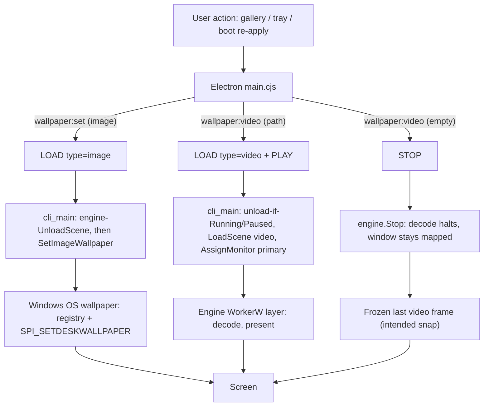

Rule of thumb: **images never touch the GPU path** (pure OS, ~zero REX
overhead); **video/audio never touch the OS wallpaper** (pure WorkerW layer).
The two outputs are stacked — OS image at the bottom, WorkerW window on top —
so anything left visible in the WorkerW window occludes any OS image (§8.3).

### 8.2 Transition matrix (all cases)

| From → To | Exact sequence | WorkerW window | Screen shows | Notes |
|---|---|---|---|---|
| none → image | `LOAD image` → `UnloadScene` (no-op, idempotent) → `SetImageWallpaper` → app `PLAY` (errors: no scene) | never acquired, stays absent | OS image | `PLAY`-after-image returns ok:false despite image applied (observed, unverified live) |
| none → video | `LOAD video` → swap-unload skipped (not Running) → `LoadScene` → `OpenVideo` → `PLAY` → decode + presents | acquired + `SW_SHOW` (`WorkerWManager.cpp:1163`) | video | `PLAY` arms first present (`Engine.cpp:572`) |
| image → video | `LOAD video` → state Initialized, no unload needed → `LoadScene` clears static texture (`Engine.cpp:439`) → `OpenVideo` → `PLAY` | acquired + shown | video | static texture explicitly cleared so video mode is unambiguous |
| video → image | `LOAD image` → `UnloadScene` (video backend closed, textures cleared, recovery disarmed, **layer hidden**) → `SetImageWallpaper` | hidden on unload | OS image visible (FIXED 2026-10-10; was: frozen frame covered it) | fix planned: hide-on-`UnloadScene`, show-on-video/audio-`LoadScene`; `Stop` keeps the snap (user decision) |
| video → video | `LOAD video` → unload (Running) → `LoadScene` → `OpenVideo` → `PLAY` | stays mapped throughout | new video (brief stale frame possible during load) | failed open drops GPU frames + ok:false so no white-noise present (`Engine.cpp:449-456`) |
| video → STOP (clear) | `STOP` → decode halts, `m_hasVideoFrame=false`, state Stopped | stays mapped, frozen | frozen last frame = intended static snap | deliberate per user decision 2026-10-10; only full `Shutdown` releases the host |
| any → `UNLOAD` | `UnloadScene`, state Initialized | stays mapped, frozen | frozen frame (video) / nothing new (static was OS-side) | recovery request disarmed here (image-cover fix) |
| any → `SHUTDOWN` / exit | watchdog/telemetry/frame-poll joined → `DetachClientSurface` → `engine.Shutdown` → `m_desktopHost.Release()` | **released/destroyed** | whatever is underneath (OS wallpaper or default desktop) | only path that removes the layer |

### 8.3 Layer lifetime (the window nobody hides)

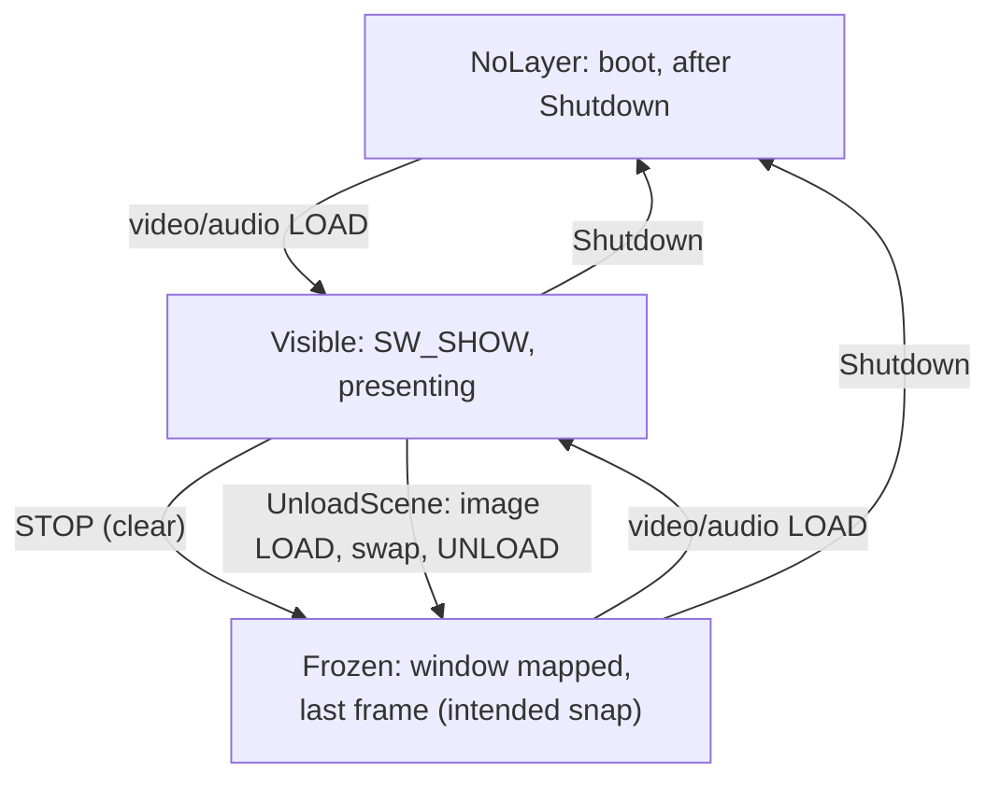

Hidden transition (was the bug, FIXED 2026-10-10): `IDesktopHost::SetVisible`
now exists on all 3 hosts — hide runs on `UnloadScene`, show on any
`LoadScene`. Before the fix there was no `SW_HIDE` in the wallpaper path,
and the dark-clear branch (`Engine.cpp:1720`) requires state `Running`, so
after unload/stop nothing ever painted over the stale backbuffer. `Stop()`'s
own comment (`Engine.cpp:621-622`) stops *re-presenting* but leaves the
window up — now the intended frozen snap, proven live (visible after STOP).

### 8.4 Video decode branches (SDR vs HDR, HW vs SW)

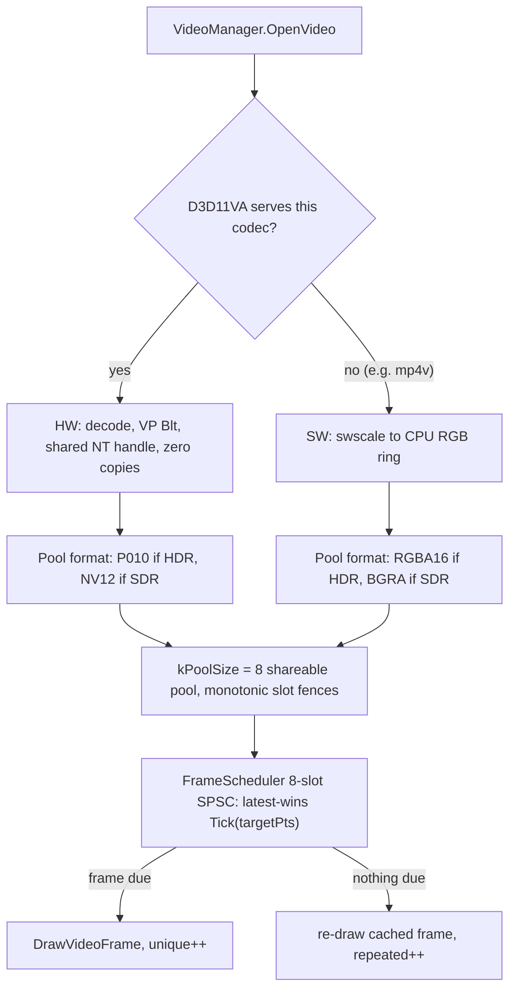

- Same-adapter invariant: D3D11 decode device is created on the D3D12
  renderer's adapter (LUID match); NT handles are invalid across adapters
  (`decRendSameAdapter=1`).
- Per-monitor: one shared decode fanned out (`PresentToAllMonitors`); second
  monitor starts muted (single-audio-owner policy).
- Known decoder limits: SW AV1-HDR fails (`send_packet -40`, TODO 🐛);
  `blk4k.mp4` trips an FFmpeg 8.1.2 CBS-AV1 assert ~2s into PLAY (HW+SW,
  upstream, bisect recipe in TODO 🐛); system ffmpeg 9.0.1 decodes it clean.

### 8.5 Pixel/output selection (content × display)

| Input | SDR output (or `--force-sdr`) | HDR output (OS HDR on) |
|---|---|---|
| static RGBA texture | `SrgbToLinear` before pipeline (`D3D12Renderer.cpp:161-162`), `LinearToSrgb` at the end | HDR PSO selected (`:1225`), `cb[3]` hdr flag (`:1769`) |
| NV12 (SDR video) | YUV→RGB then `SrgbToLinear` (`:223`); peak 80 nits (`:879`) | tone-map path per §2 rule 10 |
| P010 (HDR video) | `norm = max(paperWhite, 1.0)` (`:156`), ACES-fit, tone-map to SDR | HDR-only `max(rgb,0)` clamp (`:226-238`, highlights keep gradation), PQ-encode, peak = display max nits |

Output selection: swap-chain color space follows the OS
(`IDXGIOutput6::GetDesc1().ColorSpace`); `RefreshHdrSelection` re-runs on
every `Resize` and `CheckDisplayChanges` pass (idempotent when steady);
`--force-sdr` pins SDR format (`SwapChain.cpp:194` bail-out). HDR follows the
OS, never the file alone.

### 8.6 Cross-impacts (what each subsystem does to playback)

| Subsystem | Impact on image | Impact on video |
|---|---|---|
| Device-loss / Explorer-restart recovery | none (OS-side) | `HandleDeviceLoss` rebuilds renderer + **reloads scene + position** (`Engine.cpp:318`); disarmed by `UnloadScene` so it can't resurrect video over a new image |
| Fullscreen auto-pause | none | 1.5 s persistent-fullscreen debounce; pause folds elapsed time into position base (no rewind); user STOP/PLAY overrides auto state |
| OS HDR toggle | none (OS draws) | topology predicate fires → `RefreshHdrOutput`; pixel path needs no reaction (output follows OS) |
| Presentation cap | none | target = min(source×rate, displayHz, userCap); 60-cap was test config, not architecture; 120fps-on-160Hz valid |
| Speed (0.25x–2x) | n/a | rate-scaled wall clock; loop PTS wraps; 2x = best-effort presents |
| Mute/volume | n/a | `SET_MUTE` live-maps to engine (LOAD-time only before Ralph-3); per-monitor single owner |
| FillMode Tile | OS Path A tiles natively | refused engine-side (`LoadScene` InvalidArgument — no D3D12 tiling impl) |
| Loop wrap | n/a | decoder seeks internally → backward-PTS jump → scheduler Clear + `loopWraps++`; all drop/rep churn measured so far is wrap churn, steady state is clean (see `fps.md`) |
| Telemetry | n/a | per-sec `GET_STATUS` + 5 s native sampler; `loopWraps`/`framesConsumed`/`framesDecoded` cumulatives derive true steady-state rates |

### 8.7 Where to look (index)

- Apply entry: `app/electron/main.cjs` `wallpaper:set` (:348), `wallpaper:video` (:370, clear-STOP :374-383), boot re-apply (`startup.cjs`).
- Protocol: `rex-core/src/wallpaper_cli_main.cpp` `LOAD` image (:858), video swap (:899), `STOP/UNLOAD` (:961), `GET_STATUS` (:1179), `SetImageWallpaper` (:433).
- Engine scenes: `Engine.cpp` `LoadScene` guards (:391-405), static branch (:421), video branch (:437), `UnloadScene` (:516), `Stop` (:609), render gate (:1660), clear-color (:1720), re-present counting (:1697-1714).
- Layer: `WorkerWManager.cpp` `ReparentToWorkerW` (:1097, show :1163); release only in `Engine::Shutdown` (`Engine.cpp:226`).
- Decode/present: `VideoPlaybackController.cpp` decode thread (:367), wrap detect (:406), pacing (:460-472); `FrameScheduler.cpp` `Tick` (:11); pool formats `FfmpegVideoDecoder.hpp:163-166,234`.

---

## 9. Media apply and transition diagrams (2026-10-10)

Purpose: define what happens when REX switches between image and video
wallpapers, pauses/stops playback, unloads the scene, exits, crashes, or
recovers. Companion to §8 (which keeps the plain-text renderings and the
verified code index).

> Verification notes (checked against code before filing — take precedence
> over the diagrams where they differ):
>
> 1. **Failed video→video LOAD leaves the layer HIDDEN, not a frozen snap.**
>    The swap path unloads first (hide), and both failure returns (failed
>    open, over-budget refusal) exit `LoadScene` before the end-of-load
>    show-call — so the OS wallpaper shows. Diagram 3D's failure branch
>    ("keep stable frozen visual") is the aspiration; actual behavior (hidden
>    + OS image, no stale frame) is acceptable and arguably better. Do not
>    "fix" this into showing a stale frame.
> 2. **Diagram 6 "adapter/output" compare is adapter-LUID-only.** No output
>    friendly-name exists anywhere in the wallpaper path (verified by search).
>    EDID hash + adapter LUID + geometry + DPI + Hz is the full implemented
>    identity.
> 3. Line refs in §8 predate the P0.1/P1 insertions (file has grown since);
>    symbol names are stable, line numbers are approximate.

### Legend

CURRENT describes behavior recorded in the October 10 architecture reference.
TARGET describes the corrected behavior REX should implement.
OS wallpaper means Windows applies the image using the registry settings and
`SystemParametersInfoW(SPI_SETDESKWALLPAPER, ...)`.
WorkerW layer means the native video-rendering window/compositor.
STOP / frozen snap intentionally keeps the last displayed video frame visible.
UNLOAD removes the active scene and must not be treated as STOP.
SHUTDOWN releases/destroys the native desktop-host layer.

### Diagram 1 — Master media routing

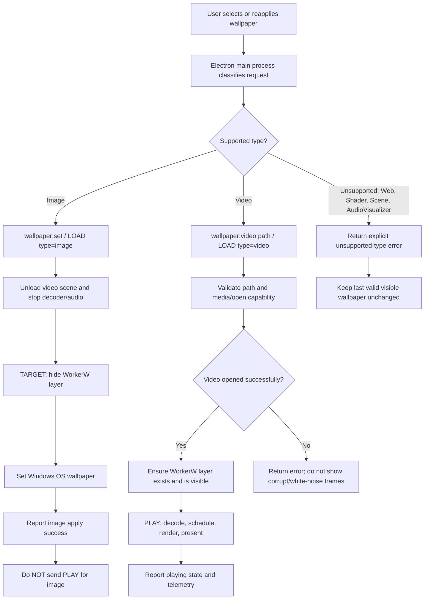

Important: image application is an OS path. It must not start the video
playback path or send a generic `PLAY` after image apply. A
failed/unsupported request must not silently report success. (Status
2026-10-10: hide-on-unload SHIPPED (P0.1); post-image `PLAY` guarded in
`wallpaper:set` — empty-scene PLAY still answers ok:false by design.)

### Diagram 2 — Wallpaper-layer state machine

```mermaid
stateDiagram-v2
    direction LR
    state "OS wallpaper only\nWorkerW absent/hidden" as OS_ONLY
    state "Video playing\nWorkerW visible" as PLAYING
    state "Video paused\ncurrent frame retained" as PAUSED
    state "STOP snapshot\nlast frame visible; position reset" as SNAP
    state "Video unloaded\nWorkerW hidden" as UNLOADED
    state "Runtime shutdown\nWorkerW released" as RELEASED

    [*] --> OS_ONLY
    OS_ONLY --> OS_ONLY: Apply image / replace image
    OS_ONLY --> PLAYING: Successful video LOAD + PLAY
    PLAYING --> PLAYING: Apply another video successfully
    PLAYING --> PAUSED: PAUSE
    PAUSED --> PLAYING: PLAY resumes from paused position
    PLAYING --> SNAP: STOP; halt playback and reset position to 0
    PAUSED --> SNAP: STOP; halt playback and reset position to 0
    SNAP --> PLAYING: PLAY restarts from position 0
    PLAYING --> UNLOADED: UNLOAD / switch to image
    PAUSED --> UNLOADED: UNLOAD / switch to image
    SNAP --> UNLOADED: UNLOAD / switch to image
    UNLOADED --> OS_ONLY: Image apply completes / remain idle
    UNLOADED --> PLAYING: Successful video LOAD + PLAY
    PLAYING --> RELEASED: SHUTDOWN
    PAUSED --> RELEASED: SHUTDOWN
    SNAP --> RELEASED: SHUTDOWN
    UNLOADED --> RELEASED: SHUTDOWN
    RELEASED --> OS_ONLY: Runtime starts without a video layer
```

Known implementation defect from the October 10 reference (FIXED same day,
P0.1 — kept here as the regression spec): `UnloadScene` left the WorkerW
window mapped with its last backbuffer, covering an image set underneath it.
The `PLAYING/PAUSED/SNAP -> UNLOADED` transitions hide the layer;
`STOP -> SNAP` leaves it visible. `UNLOAD` must never be implemented by
merely calling `STOP`.

### Diagram 3 — The important media-to-media transitions

A. No wallpaper → image

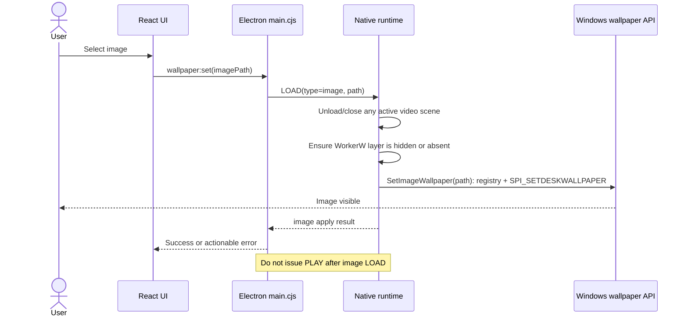

B. Image → video

```mermaid
sequenceDiagram
    actor User
    participant UI as React UI
    participant Main as Electron main.cjs
    participant RT as Native runtime
    participant GPU as D3D11VA / D3D12 pipeline
    participant Layer as WorkerW layer
    User->>UI: Select video
    UI->>Main: wallpaper:video(path, options)
    Main->>RT: INIT if needed; LOAD(type=video, path, options)
    RT->>RT: Create/load video scene and decoder
    RT->>GPU: Allocate/reuse bounded 8-slot pool; start decode
    RT->>Layer: Ensure layer is acquired and visible
    Main->>RT: PLAY only after successful LOAD
    GPU-->>Layer: Valid scheduled frames
    Layer-->>User: Video overlays the existing OS wallpaper
    Note over RT,Layer: Preserve one decoder shared by monitor compositors
```

The OS image underneath does not need to be decoded by REX. The video layer
overlays it. If the user later switches back to image, the video layer must
be hidden.

C. Video → image (confirmed bug 2026-10-10; fixed same day, P0.1)

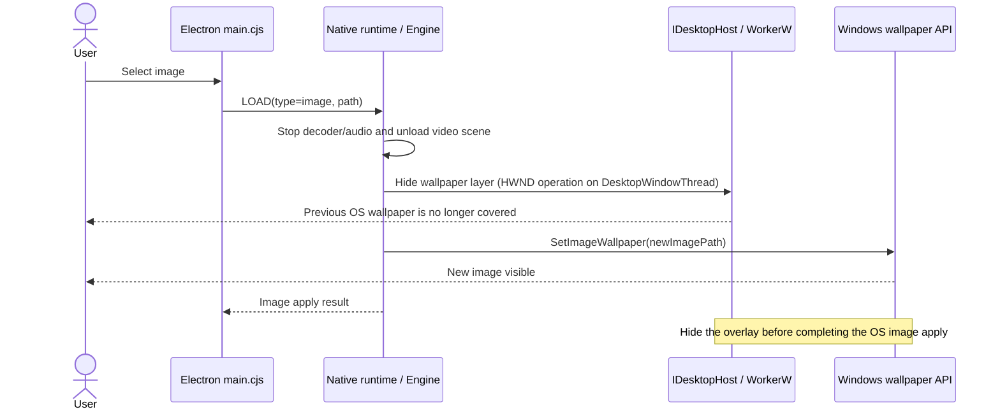

Live matrix 2026-10-10: visible=True → image visible=False → reload True →
STOP True. `PLAY`-after-image answers ok:false by design; `wallpaper:set`
treats it as expected, not a failure.

D. Video A → video B

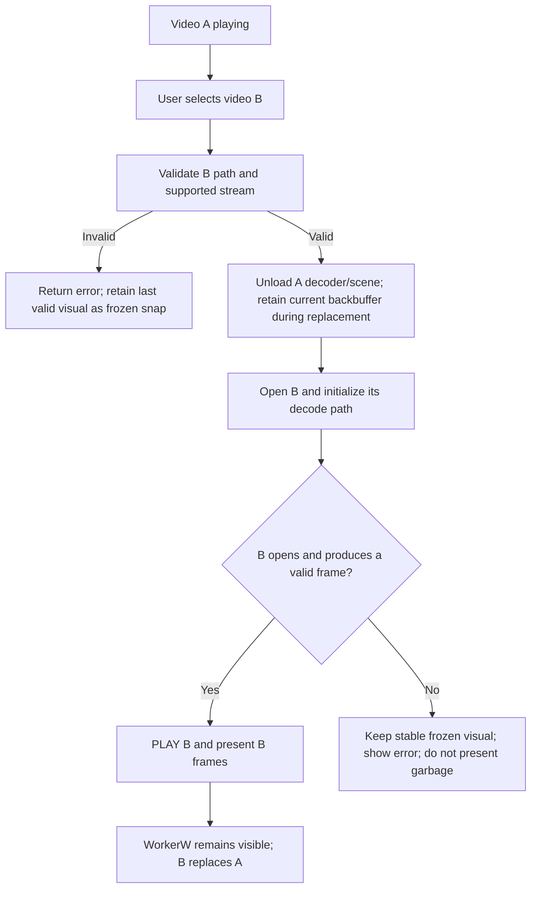

Per verification note 1 above: the implemented failure path currently leaves
the layer hidden (unload ran, show never fires) so the OS wallpaper shows —
no stale frame, no garbage. Whether to build a fully transactional "keep A
playing until B is ready" replacement is a separate design decision.

E. Image A → image B

```mermaid
flowchart LR
    A[OS wallpaper image A] --> B[Select image B]
    B --> C[Confirm WorkerW is hidden/absent]
    C --> D[Windows SetImageWallpaper(B)]
    D --> E[OS wallpaper image B]
```

No video decoder, GPU video pool, or `PLAY` command is required.

### Diagram 4 — STOP, PAUSE, UNLOAD, shutdown and crash are different

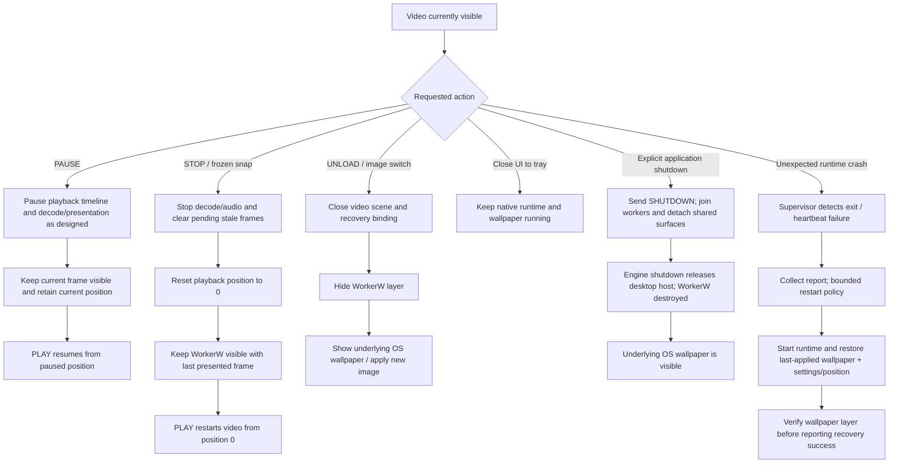

Exact semantics to enforce:

| Action | Decode/audio | Position | WorkerW | Visible result |
|---|---|---|---|---|
| `PAUSE` | Paused | Retain current position | Visible | Current frame remains visible |
| `STOP` | Halted; stale queued frames cleared | Reset to 0 | Visible | Last presented frame frozen as a snap |
| `PLAY` after PAUSE | Resume | Resume paused position | Visible | Motion resumes from pause point |
| `PLAY` after STOP | Restart | Start at 0 | Visible | Video restarts from beginning |
| `UNLOAD` | Closed | Scene position no longer active | Hidden | Underlying OS wallpaper is visible |
| `SHUTDOWN` | Workers joined and runtime stopped | Persistence/recovery state handled before teardown | Released/destroyed | Underlying OS wallpaper is visible |
| Close to tray | Continues | Continues | Visible if video active | Wallpaper continues without the main UI |
| Unexpected crash | Runtime has terminated | Restore from saved state if supervisor recovery succeeds | OS/window teardown may expose underlying image temporarily | Supervisor restarts and verifies recovery |

Key rule: STOP is the user-requested frozen snap. UNLOAD is removal of the
scene/layer. SHUTDOWN destroys the runtime's desktop host. These must not
share identical implementations. (Status: all three are distinct code paths;
P0.1 completed the visibility half.)

### Diagram 5 — Seek, loop wrap and recovery must invalidate stale frames

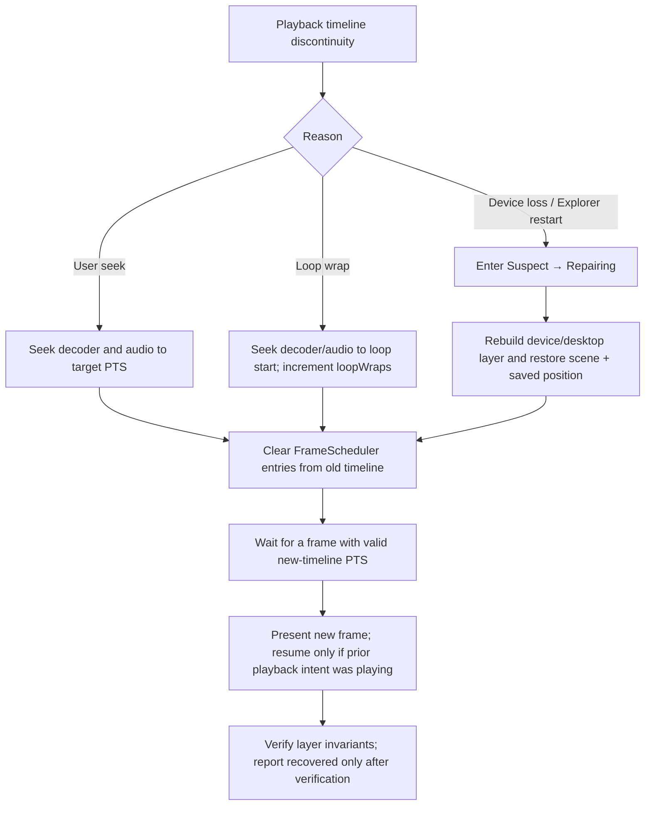

Timeline invariant: a queued frame from before a seek, loop wrap or recovery
must never be mistaken for a current frame. Playback settings (loop, speed,
volume, mute) survive reloads via `ApplyPlaybackSettings`.

### Diagram 6 — Display changes do not mean media changes

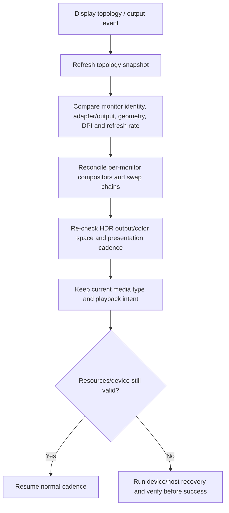

A secondary-monitor move or HDR toggle is a display reconfiguration, not
permission to reload or replace the wallpaper. "Adapter/output" here means
adapter LUID (+ EDID hash); per-monitor output friendly-names are not
implemented — see verification note 2.

### Diagram 7 — Failure handling and unsupported media

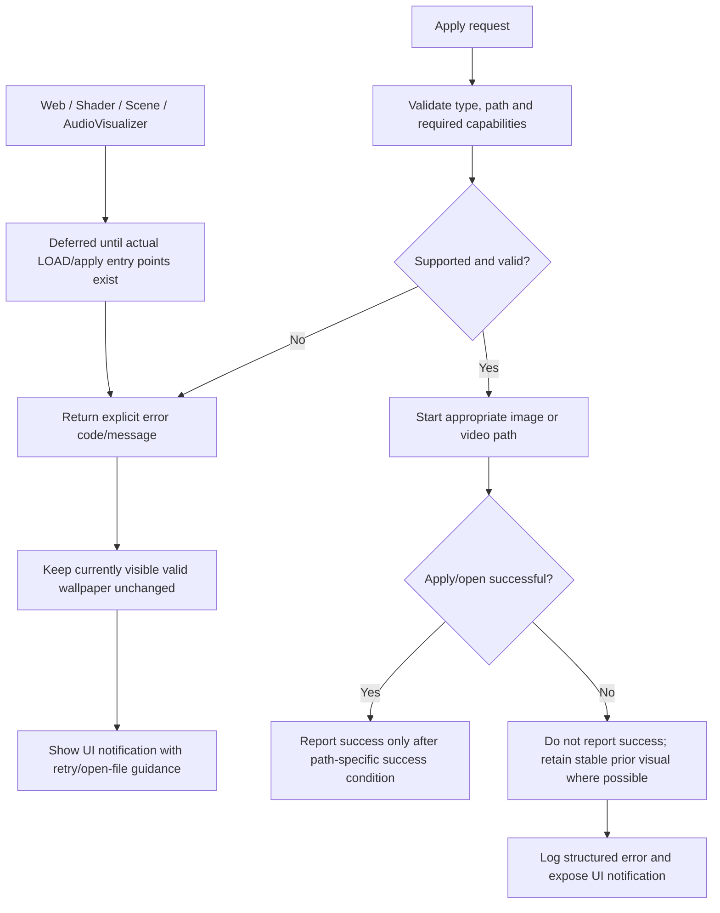

Success criteria: video success = stream accepted AND playback-ready (never
just "frame parsed"); image success = OS apply succeeded (never requires a
video scene or `PLAY`). UI notification path: `notify.js` + root `<Toaster>`
(P1); native/supervisor errors fan out as `wallpaper:event` ERROR /
recovery-gave-up.

### Transition checklist

| Transition / event | Required result | Special check |
|---|---|---|
| None → image | OS image visible; WorkerW hidden/absent | No `PLAY` after image load |
| None → video | Native video visible on WorkerW | One decoder; layer verified |
| Image → image | OS updates image | No native video activity |
| Image → video | Native video overlays OS wallpaper | Valid first video frames; no Chromium playback |
| Video → image | Video scene closed; WorkerW hidden; OS image visible | Fixed P0.1; hide/show tests in all host implementations |
| Video A → video B | B replaces A; never present corrupt/white-noise frames | Failed B load returns error; layer stays hidden → OS image (see note 1) |
| Video → PAUSE | Current frame remains; position retained | Resume from same position |
| PAUSE → PLAY | Playback resumes | No accidental seek to 0 |
| Video → STOP | Last frame remains as frozen snap; position resets to 0 | STOP is not UNLOAD |
| STOP → PLAY | Playback restarts at 0 | Decoder/audio/scheduler position agree |
| Video → UNLOAD | WorkerW hidden; underlying OS wallpaper visible | UNLOAD is not STOP |
| Video → explicit app shutdown | Runtime releases WorkerW | UI exit does not leave overlay orphaned |
| Close UI → tray | Wallpaper keeps playing | Runtime remains alive |
| Runtime crash | Supervisor restarts and restores state | Bounded retries, verify before claiming success |
| Seek / loop wrap | Old queued PTS frames invalidated | No stale pre-discontinuity frame (`loopWraps`) |
| Device loss / Explorer restart | Restore scene, playback intent and settings | Verify desktop layer before success |
| Display/HDR/monitor change | Reconcile outputs without changing wallpaper selection | Test secondary-only and HDR-only changes |
| Unsupported type / invalid file | Explicit failure, current wallpaper preserved | Never return silent success |

### Scope boundary

Image and video only (video includes its embedded audio under the
single-audio-owner policy). Web, Shader, Scene/3D, standalone
AudioVisualizer: deferred until real apply entry points exist.

### Condensed transition map

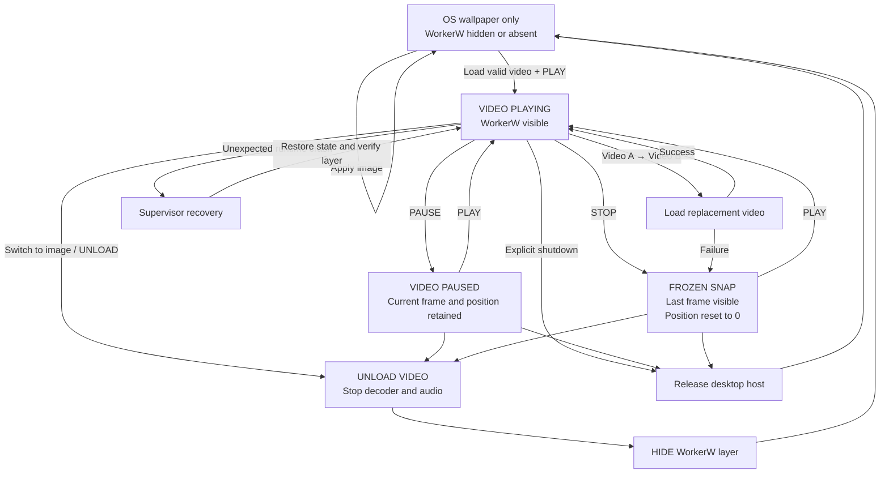

Note: the condensed map above inherits Diagram 3D's simplification
(`Failure → D` frozen snap); implemented behavior on failed swap is
hidden-layer + OS image (verification note 1). Update the map if a
transactional keep-A-until-B-ready design is ever adopted.
